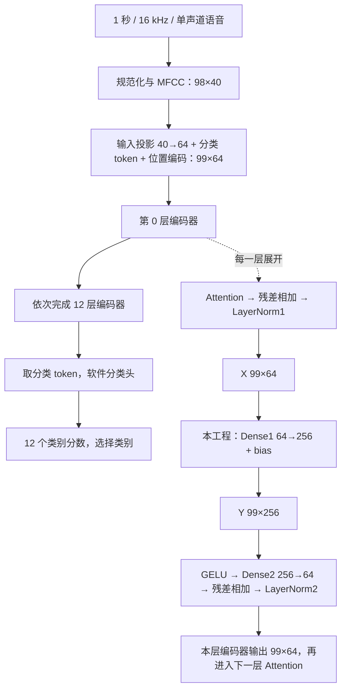

# 语音识别、赛题与本工程

## 1. 你现在写的是什么

你写的是 **E203 调用的前馈线性计算外设/协处理器**。它算一个固定尺寸的矩阵运算：

`Y[m,n] = b[n] + Σ(k=0..63) X[m,k] × W[k,n]`，其中 `m=0..98`、`n=0..255`。

- X：99×64，来自某层编码器第一处 LayerNorm 的输出；不是原始波形，也不是直接把 MFCC 填进来。
- W：64×256，b：256，从指定 KWT-1 `best_weights` 中该层第一 Dense 取出。
- Y：99×256，是 GELU 之前的线性结果；它还不是分类概率。
- 同一个硬件接受 12 套不同 W/b 和各自 X，重复完成同一种运算。`layer` 只是任务身份和合法性检查，不会替固件找权重。

来源：赛题印刷 p5、p6–7；上游 `kws_streaming/models/transformer_utils.py:87–92,113–118`；本方 `v2/implementation_spec.md`。

## 2. 一段语音经过完整模型的路径

上图的语音预处理、投影、token 与位置编码在计算机端离线完成，赛题明确不要求你开发硬件音频前端。98 行表示 98 个特征时间片，拼入一个分类 token 后成为 99 行；64 是特征维度，256 是前馈网络中间维度。batch=1 表示单次只处理一个样本，但该样本仍有 99 行特征。

类别编号必须读 `01_核心参考/keyword-transformer-master/models_data_v2_12_labels/kwt1/labels.txt`：0=`_silence_`、1=`_unknown_`，随后依次为 yes/no/up/down/left/right/on/off/stop/go。不要依据赛题文字列举次序自行编标签号。

## 3. 三种“12 层”不能混淆

| 说法 | 实际含义 | 本项目当前是否实现 |
|---|---|---|
| 模型有 12 层编码器 | 每层含 Attention、两处残差/LayerNorm、两层 Dense 和 GELU | 上游浮点模型有；本方硬件没有完整实现 |
| 硬件支持 12 层参数切换 | 用同一 Dense1 引擎执行第 0–11 层对应的独立线性任务 | 已有 W/b、输入和回归；仍需正式数据/SoC 验收 |
| 把 12 次 Y 串起来识别 | 必须补齐每两次 Dense1 之间的其余运算，才能得到正确下一层 X | 不能直接串接；Y 宽 256、下一次 X 宽 64，数学语义也不同 |

对本科评测，PC 运行原始完整浮点模型，分别截取 `out1` 作为每层 X，然后逐层交给本方数值模型/RTL。这个“提取正确测试输入”的软件过程是赛题要求；在正在测试的 Dense1 任务里，CPU/TB 不能把本应由硬件算的 `XW+b` 预先算好再写入答案。

## 4. 本科必做任务如何映射到文件

| 赛题任务 | 组合方式 | 本工程入口 | 还需补什么 |
|---|---|---|---|
| 1：64 项点积、bias、数值转换 | 乘法流水 → 40 位累加 → RNE/饱和 | `kwt_mul16_pipe`、`kwt_dot64`、`kwt_quantize`，算术 TB/整数金模 | 继续保持边界、复位、连续任务逐位一致 |
| 2：99×64×256 线性层 | 8 个点积并行 + X/W 缓存 + 全矩阵装载/写回控制 | `kwt_mac8`、`kwt_x_buffer`、`kwt_w_panel`、`kwt_linear_core`、`kwt_sp_ram` | 正式语音验证样本的逐层误差与更多样本 RTL 对照 |
| 3：E203 SoC 集成和综合 | NICE 指令层 + ICB 访存 + CPU 固件 + 正式平台 | `kwt_nice_core`、`kwt_icb_master`、`integration/`、`server_eda/` | 真 CPU、真共享 RAM、固件异常/一致性，以及统一功耗/性能报告 |

“任务 1/2 的硬件已可独立运行”不等于本科参赛工程已经完成。任务 3 是必做；当前缺口集中在正式平台和验收数据，不是必须先做 Attention。

## 5. 两种精度检查分别回答什么

**逐位正确性：RTL 是否忠实实现了你的定点算法。** 给相同整数 X/W/b，比较 RTL 与 `numeric_model.py` 的每个 int16 输出；预期是完全一致，不允许“差一点”。这能发现 signed、流水错位、丢项、舍入和写回错误。

**模型精度：你的定点算法与指定浮点模型差多少。** 把 Y_int 除以 2048 解码，与原模型 Dense1 浮点结果比较。每层汇总全部样本后计算：

`NRMSE_l = sqrt(Σ误差² / 元素总数) / max(sqrt(Σ浮点参考² / 元素总数), 1e-8)`。

本科要求 12 层中的最大 NRMSE ≤3%；不能先计算每条语音的百分比再做平均。官方 600 条样本用于精度评测；另有冻结后抽取、覆盖 12 层参数的 12 个性能任务，每个也需单独满足 3%。研究生的分类 Top-1 下降不超过 2 个百分点是另一项门槛，不要用它替换本科 NRMSE。（赛题印刷 p10–11。）

现有静音+合成音调 smoke 的最大逐层汇总 NRMSE 约 0.0522%，只能说明流程能通和这两个样本误差小，不能预测真实验证集是否合格。W/b 编码无饱和也不能推出真实 X/Y 不会饱和。

## 6. 这个模块是否能真实服务 E203

**设计目的和接口路径支持它成为 E203 的计算协处理器；当前证据尚不足以说“已经在真实 E203 SoC 中跑通”。** 已核对公共工程 32 位 NICE 请求/响应和 ICB 接口，提供同名包装及 RV32 `.insn` 调用，算术和访存控制确实由硬件完成。缺的不是让 E203 认识“语音”这个概念，而是让真实 CPU 发出指令、让双方访问同一片实际 RAM、让最后写回对 CPU 可见。

所查历史公共顶层 `sysmem` 是读零占位，尚未证明赛题 512 KiB 共享 RAM 已接通。当前 `MEM_BASE/MEM_BYTES=0` 故意关闭访存，避免猜地址；TB 的 `0x10000000` 不是正式平台地址。必须拿到正式平台窗口/译码后配置，再执行 CPU 级联调。细节见第 3 篇。

若想额外做“输入一句话、板子输出 yes/no”的演示，需要麦克风/输入链、预处理、其余模型算子及分类头的系统方案。这是额外系统开发；本科验收可以按规定的离线输入、硬件 Dense1 和 SoC 驱动完成。完整演示中其余算子的软硬件分工也不能拿来代算本科必做 Dense1。

## 7. 性能和面积报告该怎么看

- 一次本科任务是一次完整线性层装载、计算和全部写回；不是一行点积，更不是整段语音识别。
- 计时计入数据/参数装载、总线等待和 E203 调度；当前 TB 的 NICE 周期收益是局部对照，正式吞吐须在 CPU/平台计时窗口重新测。
- 新增加速器、接口和内部 SRAM 面积合计 ≤2.25 mm²；复用的 CPU/共享 RAM 单列。库面积数值须确认单位及宏口径才能判预算，不能看到小数字就认定通过。
- 功耗/能耗须同一冻结配置，统计 CPU、加速器、互连、SRAM 的活动；当前尚无完整这套报告。
- 150 MHz 是统一综合时序目标。布局布线/CTS/流片不是本赛题必做，不能因尚未做这些便断言无法参赛；反过来，零报告违例也不能掩盖不完整约束/覆盖。（赛题印刷 p3、p11–12。）

工作日志：2026-11-01 新建；引用赛题印刷页码，不使用 PDF 阅读器页序代替。当前模型处理路径核对上游 `transformer_utils.py:87–118,167–188`、本方 `capture_activations.py:35–81`。没有新增模型训练或真实数据验收声明。
