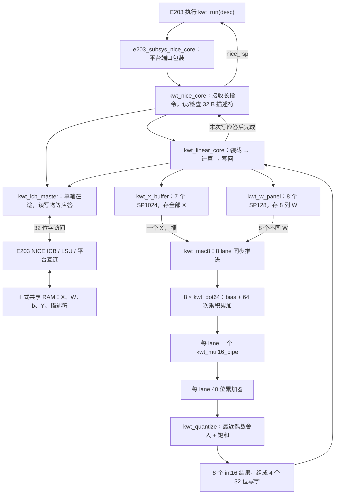

# 硬件模块怎样组成完整线性加速器

本文按 v2 讲解；v1 的区别列在末尾。所有尺寸、位宽与次序来自当前源码和 `v2/implementation_spec.md`，不是可随意改动的建议值。

## 1. 先分清五类文件

| 类型 | 在哪里 | 是否变成芯片逻辑 |
|---|---|---|
| RTL | `v2/rtl/*.sv`、`integration/e203_subsys_nice_core.v` | 是：运算、状态机、接口、宏实例 |
| 测试平台 TB | `v2/tb/` | 否：模拟 CPU 请求/内存、制造等待和错误、检查结果 |
| 软件金模/转换 | `v2/py/` | 否：定义整数算法、导出权重与期望结果，在 PC 上运行 |
| 驱动 | `v2/integration/kwt_driver.h` | 编译成 E203 执行的指令，不是硬件门电路 |
| 工具脚本和报告 | `vm_eda/`、`server_eda/`、`build/` | 脚本驱动 EDA；网表是 RTL 映射结果；报告是验证证据 |

TB 内存能给出正确数据，只证明模块在这个模拟环境里工作；它没有自动替你造出正式 E203 系统中的共享 RAM。

## 2. 控制和数据走两条相互配合的路径



共享 RAM 在加速器外部，供 CPU/平台和加速器交换任务；内部 SRAM 是加速器自己的工作缓存。这里没有新 DDR 控制器，也没有把完整 12 层模型永久塞进内部 SRAM。

## 3. 10 个模块各负责什么

| 模块 / 数量 | 输入和输出 | 内部职责 | 出错常影响哪里 |
|---|---|---|---|
| `kwt_nice_core` ×1 | NICE 指令/rs1 → 任务；返回状态；对外 ICB | 检查 custom3 编码，读 8 字描述符，检查 magic/format/layer/地址，任务期间保持忙，完成响应支持背压 | 指令无法启动、描述符错读、提前完成、错误处理 |
| `kwt_icb_master` ×1 | 内部读写请求 ↔ 平台 32 位 ICB | 保持命令到握手；最多一笔；接受同拍或延迟响应；写也必须等响应；固定 size=word | 总线等待死锁、重复写、读写应答错配 |
| `kwt_linear_core` ×1 | X/W/b/Y 地址和层号 → 写回矩阵/状态 | 检查对象范围与互斥，循环列组/行/k，控制缓存、bias、MAC、输出；v2 重叠相邻行 | 行列错位、漏写、多写、层参数串用 |
| `kwt_x_buffer` ×1 | 两次 16 位写 / 一次同步读 → 单个 X | 全部 6336 个 X 存入 7 bank；高位选 bank、低 10 位寻址；bank 与 valid 一起延迟 | bank 边界错、X/W 对齐差一拍 |
| `kwt_w_panel` ×1 | 一个总线字拆成两个 lane 写；读 k → 8 个 W | 每 lane 独立 SRAM；当前 8 列的 64 行权重驻留，给 99 行 X 重复使用 | lane 交换、k/列组地址错误 |
| `kwt_mac8` ×1 | X16、W128、bias256 → Y128、acc320 | 8 个 lane 原子接收同一 k；全部 ready 才一起喂数，全部 valid 才一起交结果 | 个别 lane 漏项或不同步 |
| `kwt_dot64` ×8 | bias32 + 64 对 X16/W16 → Y16/acc40 | bias 初始化一次；只收 64 对；等最后乘积离开流水后量化；结果保持至 ready | bias 重加、末项丢失、旧任务残留 |
| `kwt_mul16_pipe` ×8 | signed16×signed16 → signed32 | v2 操作数寄存 → 两个精确部分积 → 合并；valid/last 同步，II=1 | 负数/最低值错、valid 与 product 错位 |
| `kwt_quantize` ×8 | signed40 → signed16 + saturated | 最后一次右移 16 位、RNE、越界夹到 int16；不在每次 MAC 中截断 | 舍入边界、负数 tie、饱和误差 |
| `kwt_sp_ram` ×15 | 通用同步 RAM 端口 ↔ 实际宏 | 将 7×SP1024 和 8×SP128 绑定到行为模型、厂商模型或综合 cell | 宏极性/位掩码/读延迟和综合分支 |

另一个文件 `integration/e203_subsys_nice_core.v` 是**平台同名适配层**，把平台端口/配置交给 `kwt_nice_core`，不再计算一次矩阵。`tb/kwt_sram_sim.sv` 是行为存储模型；它不是应提交为工艺宏的 RTL。

## 4. 以一个具体输出说明“8 lane”

第 `g` 个列组对应 `n=8g..8g+7`。取某一行 m：

1. lane j 的累加器先装 `b[8g+j]`。
2. k=0 时，缓存读出 `X[m,0]` 和 8 个 `W[0,8g+j]`；X 广播给全部 lane，各 lane 乘自己的 W。
3. k=1..63 重复，8 个累加器分别得到 8 个输出的完整和。
4. 各 lane 舍入饱和，得到 `Y[m,8g..8g+7]`；16 B 结果拆成 4 次 32 bit 写。
5. 同一权重列组继续服务下一行，直到 99 行；再装下一组 8 列权重。共 32 个列组覆盖 256 列。

因此 8 lane 是“同时算一行的 8 个输出通道”，不是同时执行 8 层模型，也不是把 64 项求和一次全并行展开。每次任务包含 99×256=25344 个点积、1622016 次标量乘法；8 lane 的操作数发射拍数为 99×32×64=202752，实际总周期还含装载、流水、握手和写回。

## 5. 一次任务的全程

| 阶段 | 硬件动作 | 检查点 |
|---|---|---|
| 接收 | CPU 执行长指令，rs1 指向描述符；只在空闲接受 | 指令位正确，rs1 是字节地址，窗口已配置 |
| 描述符 | 连续读取 8 个 32 bit 字：magic/format/layer/X/W/b/Y/reserved | 每个对象 4 B 对齐、范围合法、彼此不重叠 |
| X 装载 | 3168 次总线读，每字拆两个 int16，全部写入 X SRAM | X 缓存未装满不开始计算 |
| 列组装载 | 当前 8 列 W：256 个总线字；bias：8 个字 | W 行优先跨度 512 B，不需要离线转置 |
| 计算 | 每行 INIT→FEED 64 次同步读→DRAIN；乘法数据按 valid 排空 | X/W 同拍有效；最后一项确实已累加 |
| 写回/重叠 | 结果寄存到 y_hold；4 个写请求逐个等应答，同时算下一行 | 慢写回时下一行结果停在 MAC 响应寄存器，不覆写 y_hold |
| 换组 | 完成当前列组全部 99 行后，才加载下一组 W/b | 不跨列组预取，不并发多个 ICB 事务 |
| 完成 | 最后一个 Y 字写应答成功，才向 NICE 返回 | 返回 0=成功；错误输出全部视作无效，不靠部分 Y 继续推理 |

主状态来自 `kwt_linear_core.sv:22–24`；相邻行 prefetch 状态与 y_hold 位于同文件约 34–49、112–164 行。内部 `core_cycles` 和饱和计数目前用于 TB 观察，没有包装成完整的 CPU 可读性能寄存器。

## 6. 数值与存储是同一个契约

| 对象 | 编码 | 解码/精度 | 每任务字节数 |
|---|---|---|---:|
| X | signed int16，F=11 | int / 2048 | 12672 |
| W | signed int16，F=16 | int / 65536；不是常见的 F=15 | 32768 |
| b | signed int32，F=27 | int / 134217728 | 1024 |
| 乘积/累加 | signed32 / signed40，F=27 | 64 项完整加和，无中间量化 | 内部寄存器 |
| Y | signed int16，F=11 | 累加结果右移 16 位，RNE 后饱和 | 50688 |
| 描述符 | 8×uint32 | 地址/格式，不作定点解码 | 32 |

外部总计 97184 B。内部 X 用 7×1024×16=14 KiB，当前 W 用 8×128×16=2 KiB，共 16 KiB，不保存全部 Y。单口 SRAM 的同一 bank 不能在一拍任意双读写；本架构把装载与该 bank 的计算读分阶段安排，v2 重叠的是“读 X/W 计算”和“经外部 ICB 写 Y”。

低半字优先时，32 bit 字低 16 位放相邻两个元素中的前一个。`PACK_LOW_FIRST=0` 只交换这两个半字，不会自动解决整个 CPU 大小端、bias 或描述符字节序。外部地址：

```text
X(m,k) = X_base + 2*(64*m+k)
W(k,n) = W_base + 2*(256*k+n)
b(n)   = B_base + 4*n
Y(m,n) = Y_base + 2*(256*m+n)
```

总线一次正常任务为 24296 个 word 事务：描述符 8、X 3168、W 8192、b 256、Y 写 12672。此计数不包含额外 CPU 对存储的访问，也不代表 CPU 总指令数。

## 7. 为什么要看 ready、valid 和 last

`valid && ready` 在时钟沿同时为 1 才算接收一次；等待 ready 时数据保持。总线、任务和结果接口遵循这个规则。乘法流水内部没有任意停顿接口，输入是否有效通过 valid 表示；最后一项通过 last 随数据延迟，不能在“发出第 64 个输入”时就提前宣布计算结束。

复位清控制/valid/计数，不清 SRAM 全阵列，因此每个新任务必须重新装输入和参数。v2 的同步 clear 会清计算流水和预取状态，保证写错误后不把旧行带入新任务。当前要求 CPU/NICE/应答域共同复位；局部复位而旧总线响应继续返回的情况尚不支持。

当前没有硬件超时/自动重试；若平台不给响应，模块会一直等。系统超时策略应由正式平台联调决定，而不是让 TB 假造响应来宣称通过。

## 8. v1、v2、fix1 分别改了哪一层

| 版本 | 功能算法 | 计算/调度 | 实现与验证 |
|---|---|---|---|
| v1 | 同一整数格式和 99×64×256 运算 | 单级寄存乘法，较保守顺序执行 | 对照基线 |
| v2 | 与 v1 输出逐位相同 | 三级精确乘法；当前行写回与下一行计算重叠；仍 8 lane/15 宏/单笔 ICB | 固定等待 TB 的 NICE 周期 4838364→3860700，减少 20.2065% |
| fix1 | 不改原 20 个 RTL 文件 | 不增加额外周期收益 | SMIC40 等功能单元调整；VM BUFX2 缓冲修复；新双角/SDF 证据 |

v2 的收益不是“增加到更多乘法器”，也不是“整语音模型加速 20%”；它是在同条件、局部线性任务测试中减少等待。fix1 则说明：相同 RTL 在不同工艺/工具下可能映射出不同短路径和负载问题，需要各自修实现，不能把 SMIC40 的单元名字搬进 GPDK045。

工作日志：2026-11-01 新建；按现有 RTL 实例关系和尺寸核对，未改变源码/位宽/状态机。更细的端口/状态定位见 `v2/rtl/README.md`，数值契约以 `v2/implementation_spec.md` 为准。
