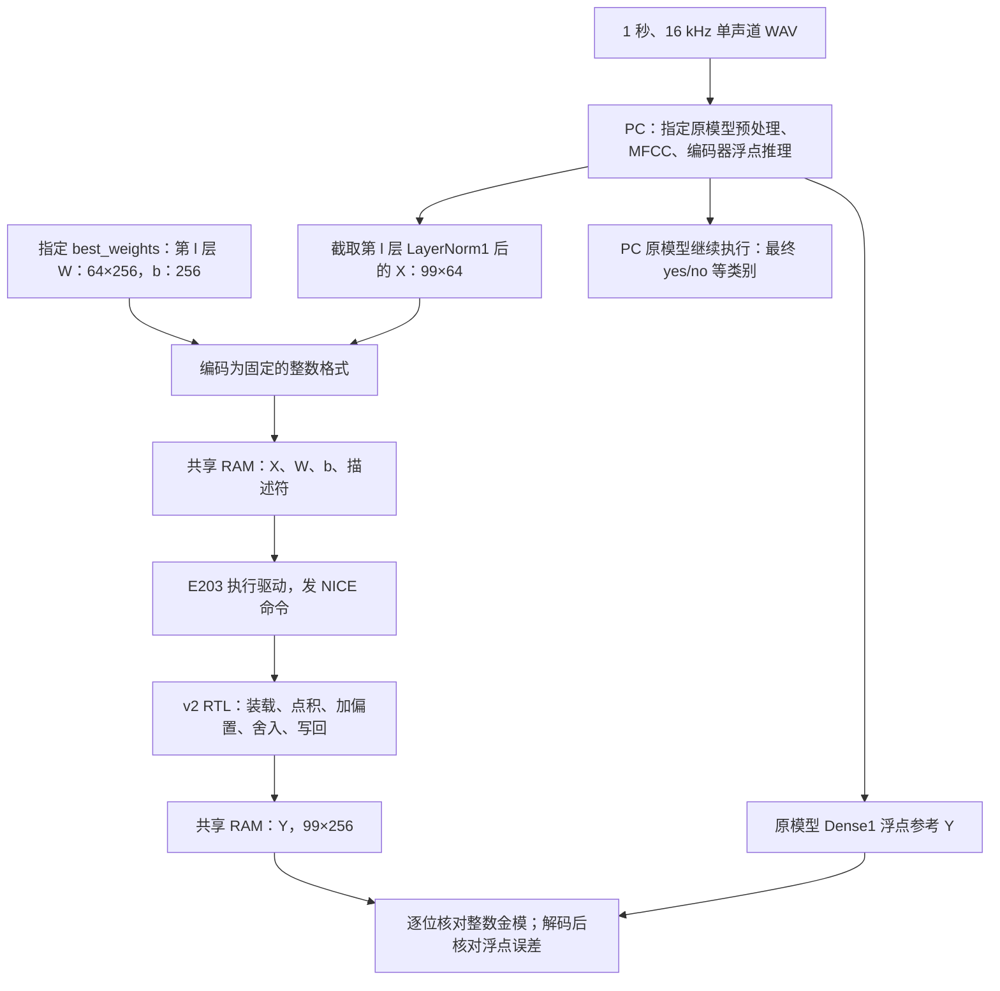

# 本科语音验证：交付矩阵，还是输出 yes/no？

**本科必做硬件输出是 `Y[99,256]` 矩阵。还必须完成 E203 调度、内存交换、SoC 仿真和综合；只在电脑上生成矩阵文件不能算完成比赛。硬件直接识别出 `yes/no` 不是本科必做门槛。**

依据：赛题印刷第 5 页（PDF 第 6 页）第 5 条；印刷第 7—8 页任务 1—3；印刷第 10—11 页精度和吞吐量规则。原件见 [赛题 PDF](../01_核心参考/赛题介绍.pdf)，可搜索的原文见 [文本](../01_核心参考/赛题介绍_原文.txt:94)。

## 1. 语音与这个 RTL 的关系

完整 KWT-1 是一个英文短指令分类模型。它把一秒语音分为十个目标词、静音、其他语音，共 12 类；不是把一句话转成文字。原模型的大部分计算在本项目本科验证中由 PC 离线执行，用于产生硬件实际需要的输入。



当前 RTL 仿真用 TB 代替图中的 E203 和共享 RAM 接口环境。TB 发命令、提供输入和比较结果；点积、累加、舍入与输出数据由 RTL 实际计算。把 TB 换成真实 CPU、驱动和平台 RAM，并保持结果正确，才补上任务 3 的 SoC 证据。

## 2. 哪些事必须做

| 阶段 | 输入与输出 | 本科必须证明的内容 |
|---|---|---|
| PC 离线准备 | WAV → 原模型每层 X，以及对应 W/b、浮点参考 Y | 指定模型、指定 checkpoint、推理模式；无训练、随机增强或 Dropout |
| 任务 1 | 64 对数值和偏置 → 一个点积结果 | 符号、乘积、累加位宽、RNE、饱和、复位和连续输入正确 |
| 任务 2 | X 99×64，W 64×256，b 256 → Y 99×256 | 真正由 RTL 完成计算；12 层参数可切换，装载、缓冲、写回正确 |
| 数值验证 | 解码后的整数金模 Y 对比浮点 Y | 每层汇总全部样本算 NRMSE，12 层最大值 ≤3%；RTL 对金模逐位一致 |
| 任务 3 | E203 驱动启动硬件并读取结果 | 实际 SoC 仿真、驱动、共享内存、状态管理；综合、150 MHz 时序、面积和功耗报告 |
| 自主选做 | GELU、Dense2、注意力或更多完整模型功能 | 不替代任务 1—3；需要独立实现与验证，不能因浮点模型能分类就宣称 RTL 已具备这些功能 |

**一段语音会产生 12 套不同的 X/W/b。** 第 l 层 Dense1 的 Y 有 256 列，下一层 Dense1 的 X 只有 64 列，中间还隔着 GELU、Dense2、残差、LayerNorm 和注意力。不能把本模块一次的 Y 直接当作下一次的 X，也不能简单连续调用 12 次就称为完整识别器。

## 3. 本轮数据与可复现命令

数据使用上游 [指定版本 README 的 Google 下载地址](https://github.com/ARM-software/keyword-transformer/blob/237e4097/README.md)。用户提供的 Kaggle 页标为 Google Speech Commands V2，但本轮直接取得原始 `speech_commands_v0.02.tar.gz`，有大小和 MD5 校验，不依赖镜像与原包一致的假设。

`_background_noise_` 保存训练时混入的长背景音；本轮不拿它当目标词。十个目标词来自对应目录，其他语音来自非目标词目录；静音按赛题要求使用 16000 点全零。验证 WAV 同时匹配原包 `validation_list.txt` 和指定源码 `which_set()`，并排除 `testing_list.txt`。

本轮固定选择每类 50 条，共 600 个验证用例：550 个不同真实 WAV + 50 次同样的全零静音。清单、音频 SHA、逐样本/逐层误差和原浮点模型分类都保留；没有改变权重或本项目数值格式。这是自选调试清单，**不是组委会最终公布的 600 条评测清单**。

在 `server5-10user` 根目录运行：

```powershell
python v2/py/summarize_real_speech.py --capture v2/validation_real_speech_20261102 --snapshot
python v2/py/download_speech_commands.py --out datasets/speech_commands_v0.02
python v2/py/run_model_python.py v2/py/qualify_real_speech.py --data datasets/speech_commands_v0.02 --out v2/validation_real_speech_20261102
python v2/py/run_real_speech_rtl.py --capture v2/validation_real_speech_20261102 --jobs 2
python v2/py/summarize_real_speech.py --capture v2/validation_real_speech_20261102
```

数值截取命令需要保留的 Windows Python 3.8 + TensorFlow 2.4；启动器使用相对路径定位，绕开迁移前 venv 内失效的绝对路径。其他电脑需根据 `v2/requirements-tf24.txt` 建兼容环境。RTL 命令使用本机 Vivado XSim 2023.2，检查完整 40 位累加值和 16 位写回结果；最后一条命令核对证据并生成中文报告。实际结果以 [本轮验证目录](../v2/validation_real_speech_20261102/README.md) 为准。

## 4. 怎样看错误

| 现象 | 首先检查 |
|---|---|
| 原模型预测标签不对 | 音频标签、划分、预处理、checkpoint；模型本身也可能误分类，不能直接归罪 RTL |
| RTL 与整数金模不同 | 第一处出错的 layer/row/group/lane；依次查装载、X/W 对齐、累加、舍入、字打包和写回 |
| RTL 与金模相同，但 NRMSE >3% | 数值格式是否能覆盖真实激活范围；只能用训练划分标定，再重新在验证划分检验，不能用测试集调参数 |
| BFM 仿真正确，E203 上不工作 | 正式共享 RAM 地址、NICE 指令译码、端口宽度、复位域、写响应和固件启动；TB 示例地址不代表硬件地址 |
| 功能正确但时序不满足 | 真实工艺、综合网表、约束、SRAM 与路径；功能仿真不能证明 150 MHz |

NRMSE 应先把某一层的所有样本误差平方累加，再开方并除以该层浮点参考的 RMS；不是先算每条误差百分比再取平均。组委会还会抽 12 个性能任务覆盖 12 层，每个任务独立要求 ≤3%。

## 5. 何时才能说“真实服务 E203”

必须实际让 RISC-V 固件在赛用 E203 中运行：把合法的 X/W/b 和描述符放入平台共享 RAM，执行约定的 NICE 指令，等写回完成，再读取 Y 并核对。地址和指令配置需由真实平台确认；本项目 `MEM_BASE/MEM_BYTES` 默认关闭，BFM 的 `0x10000000` 不是可直接照搬的正式地址。

真实语音验证能增加“这个 Dense1 算法和 RTL 对真实模型数据正确”的证据。它仍不能替代 CPU/共享 RAM 的 SoC 仿真，也不能证明整机从麦克风到 `yes/no` 已运行。原浮点模型在 PC 输出的 `yes/no` 仅帮助理解整个应用。
