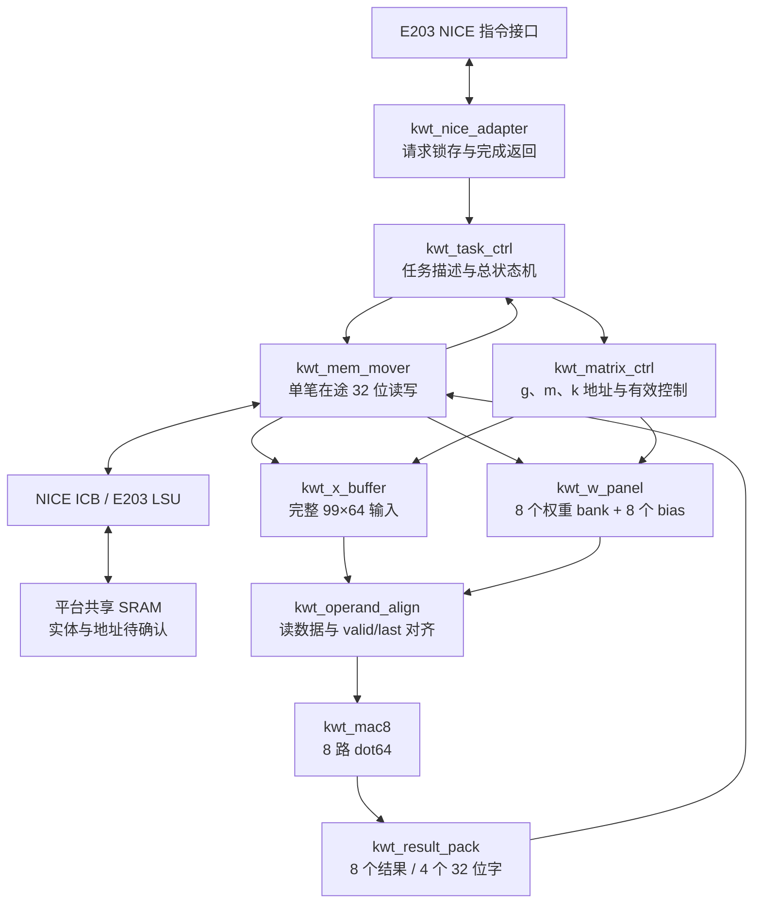

# 本科任务 1 和任务 2 的保守 RTL 架构提案

日期：2026-11-01。本文主体保留最初架构构思；用户后续已要求实施，实际生成与验证决定见文末 §12。当前结果在 `v1/`，不能把旧阶段“尚未实现”的描述当成最新状态。

建议采用 **8 路并行、每路串行累加 64 项的点积引擎，完整缓存一份 X，每次缓存 W 的 8 列，按组写回 Y**。计算主体与 NICE 适配、SRAM 宏包装分离。单任务、单缓冲、单笔在途访存是第一版的保守选择。

文中 `[已确认]` 表示本轮原件核对，交接转述另行注明；`[推断]` 表示计算或设计建议；`[待确认]` 不能当作正式平台参数。模块名、状态名和描述符字段均为本方提案，不是官方接口名。

## 1 目标及模型边界

[已确认] 本科任务 1 是长度 64 点积、偏置和数值处理；任务 2 是：

`Y[m,n] = b[n] + Σ(k=0..63) X[m,k] × W[k,n]`

`X:99×64，W:64×256，b:256，Y:99×256，batch=1`。必须支持 12 层对应参数逐次替换。依据赛题印刷 p5—7，即 PDF 文件第 6—8 页。[赛题原文](../../01_核心参考/赛题介绍_原文.txt)

[已确认] X 必须是对应编码器 Attention、第一次残差与 LayerNorm 后的 `out1`；Y 位于第一 Dense 加偏置后、GELU 前。首层编码器输入也为 99×64，但不能因形状相同就把它直接当作第一 FFN 输入。依据 [transformer_utils.py](../../01_核心参考/keyword-transformer-master/kws_streaming/models/transformer_utils.py) 第 87—118 行。

12 次任务是分别计算 12 组第一 Dense，不是把 Y[99,256] 直接接回下一层 X[99,64]。Attention、GELU、第二 Dense、第二次残差/LayerNorm 和分类不在本轮必做 RTL 中。完整语音识别验证仍需指定模型的其余运算链路；完成本提案不能称为全模型硬件识别器。赛题第 3 项的驱动、SoC 仿真与综合仍是本科参赛必做内容，本轮只规划其接口边界。

[已确认] README 的 KWT-1 `mlp-dim=128` 与赛题不一致；本地 `flags.json` 的 `mlp_dim=256`、训练图中 12 组第一 Dense 的 kernel=(64,256)/bias=(256,) 和论文表 1 均支持 256。上游指定提交的[配置](https://raw.githubusercontent.com/ARM-software/keyword-transformer/237e4097/models_data_v2_12_labels/kwt1/flags.json)也为 256。不得按 README 的 128 缩小硬件。

## 2 候选方案及选择理由

下表仅比较 MAC 发射拍数；不含 SRAM 延迟、命令、流水填排、量化、搬运和总线等待，不能当作实测性能。

| 方案 | 并行乘法器/累加器 | 每拍计算供数 | 理想 MAC 发射拍数 | 判断 |
|---|---:|---|---:|---|
| 1×1 标量点积 | 1/1 | 1 个 X、1 个 W | 1,622,016 | 调试最简单，保留为验证及面积回退方案 |
| **1×8 向量点积** | **8/8** | **1 个 X 广播、8 个 W** | **202,752** | **建议第一版；只扩展输出列，控制规则整齐** |
| 1×16 向量点积 | 16/16 | 1 个 X 广播、16 个 W | 101,376 | 后续有完整验证和面积余量时再比较 |

[推断] 8 整除 256，行方向一次只做一行，99 行无需补齐或屏蔽尾块。每条 lane 的结果一直留在本地 40 位累加寄存器中，完成 64 项之后再量化，属于经典输出驻留点积。权重按列组驻留，跨 99 行复用；完整 X 跨 32 个列组复用。

此前交接列出的 4×16、8×8、9×8 是候选而非已冻结设计。按本轮“经典、可靠、保守”的优先级，先用 1×8，减少同时供数、累加状态和边界处理复杂度。其缺点是吞吐量较低，X 需在内部读 32 遍，且单笔访存不能隐藏总线延迟；不能预先承诺效率分数。

第一版按“装载—计算—写回”分阶段执行；不依赖双口同址读写、突发或多笔乱序返回。后续优化须用同条件端到端测量说明收益。

## 3 模块及相互关系



| 提案模块 | 职责、主要关系 | 必须守住的边界 |
|---|---|---|
| `kwt_nice_adapter` | 接 NICE 请求；锁存指令/描述符指针；持有最终响应 | CPU 背压时保持响应及错误；只接收一项长任务 |
| `kwt_task_ctrl` | 读取并核验描述符，管理装载/运行/写回/错误 | 忙时配置不可变；完成必须等最后写响应 |
| `kwt_mem_mover` | 通过逻辑存储请求端口读 X/W/b、写 Y；由适配层变成 NICE ICB | 仅一笔在途；命令接受与响应完成分别计数；不称为平台已有 DMA |
| `kwt_x_buffer` | X 行优先存储；每个有效计算拍提供一个 16 位 X | 整任务装载完成才可读；复位只清有效状态 |
| `kwt_w_panel` | 8 个单口 bank，每 bank 存一列的 64 个 W；8 个 bias 暂存 | 同组权重用于全部 99 行后才能覆盖；装载与计算分时 |
| `kwt_matrix_ctrl` | 遍历 g=0..31、m=0..98、k=0..63 | SRAM 读请求、算术接收、总线响应各用自己的计数/握手 |
| `kwt_operand_align` | 对齐 X/W 延迟，寄存完整操作数组与 last 标记 | 未凑齐 1X+8W 不发算术 valid；读流水需要明确返回空间 |
| `kwt_mac8` | 同步启动 8 路长度 64 点积，广播 X，各取一列 W | 每路 bias 只加一次，64 项全精度相加；8 路事务原子推进 |
| `kwt_dot64` | 标量命令/64 对输入/结果握手；含乘法流水、40 位累加、量化 | 独立验证任务 1；命令与第 1 对数据不强行同拍 |
| `kwt_mul16_pipe` / `kwt_quantize` | 完整 signed 乘积；最终 RNE 与饱和 | 无背压乘法流水不能被随意冻结；不在中间和处截断 |
| `kwt_result_pack` | 锁存一组 8 个输出并组成 4 个 32 位写数据 | 每个字等写响应后再推进；部分写回出错则整个任务失败 |
| `kwt_sram_sp_wrap` | 统一内部读写接口，分别绑定 SP1024/SP128 宏 | 深度各自查端口；控制极性、延迟、固定脚由真实模型决定 |

内部建议使用明确 `valid/ready` 的任务、操作数和结果接口，所有载荷在等待期间稳定。宏读本身没有 ready 返回，包装必须按实际读延迟产生 `rd_valid`，并保存请求对应的 bank/地址/last；不能只延迟数据而遗漏控制。

S1 实物恢复后，可以实例化 8 个已核验 `kwt_dot64`；也可依照同一数值契约重建。8 路输入必须共同接受一个 k，8 路结果必须共同转移到结果寄存器，禁止某一路单独握手而重复/漏算。S1 文件本轮不存在，不能声称已经复用原代码。

## 4 存储组织与数据布局

[推断] 暂按交接 S1 格式预算：X/W/Y 为 16 位，b 为 32 位。

| 对象 | 逻辑大小 | 建议实现 | 说明 |
|---|---:|---|---|
| 全部 X | 6,336×16 bit = 12.375 KiB | 7 个 SP1024×16，物理 14 KiB | 线性地址 a=m×64+k；bank=a/1024，宏内地址=a%1024 |
| 当前 W 列组 | 64×8×16 bit = 1 KiB | 8 个 SP128×16，物理 2 KiB | lane i 存 W[k,8g+i]，地址 k=0..63 |
| 当前 bias | 8×32 bit = 32 B | 8 个计算参数寄存器 | 每组装载后保持，初始化每行的 8 个累加器 |
| 当前累加 | 8×40 bit = 40 B | 8 个累加寄存器 | 不把部分和反复写 SRAM |
| 当前输出 | 8×16 bit = 16 B | 结果寄存器及小型发送保持寄存器 | 没有 99×256 的内部完整 Y 缓冲 |

提案内部 SRAM 总物理容量为 **16 KiB**，未把计算/握手寄存器算作 SRAM；不能据容量直接断言面积合格。两类宏共 15 个实例，真实面积必须逐个计入。

[待确认] 交接仅列出 SP128 文件路径，尚未给其完整端口和行为。若 SP128 暂不能绑定，W 的 8 个 bank 可各换为 SP1024，总 SRAM 变成 **30 KiB**；功能和调度不变，但面积/功耗需重新评估。即便 SP1024 包装端口有记录，其本体正常时序仍未闭合。不能把“128/1024 都存在”当作可直接同构例化的证据。

单口供数是成立的：计算阶段 X 只读一个 bank，W 的 8 个 bank 各读一个字；装载阶段停止计算。X 的一次 32 位外存读包含两个半字，包装先锁存整个字，再用两个写周期写入单口 X bank；不要在同一单口宏同一拍写两个地址。W 的两个半字可写入两个不同 lane bank，具体时序由装载控制保证。

保留普通行优先布局，不要求离线重排矩阵。以下是**拟定的字节寻址布局**，须在正式平台确认地址单位和端序后冻结；物理基址现在不分配：

```text
X(m,k): X_base + 2 × (64m + k)
W(k,n): W_base + 2 × (256k + n)
b(n):   B_base + 4 × n
Y(m,n): Y_base + 2 × (256m + n)

当前 g 组、j=0..3 的 W 读字: W_base + 2 × (256k + 8g + 2j)
当前 g 组、j=0..3 的 Y 写字: Y_base + 2 × (256m + 8g + 2j)
```

建议基址均 4 字节对齐，全程用对齐 32 位访问。逻辑上一个字装相邻两个 int16；低索引对应哪组数据位、字节序及 b32 顺序仍待确认，不能直接假定 NPZ 或主机端序就是总线 ABI。地址范围加法使用额外进位位检测 32 位回绕；确认平台保留区后检查 X/W/b/Y/描述符合法范围及不重叠。

## 5 完整执行顺序

1. 接受一项任务，锁存描述符及格式版本；校验层号 0..11、范围、对齐等，清除旧装载有效状态。
2. 装载全部 X，完成 6,336 个半字写入后才置 `x_valid`。
3. 对 g=0..31，读取当前 8 列 W 的 512 个值和 8 个 bias，完成后置 `panel_valid`。
4. 对 m=0..98，将 8 个 bias 符号扩展后分别初始化 8 个累加器；发出 k=0..63 的读请求。
5. X/W 返回对齐后共同送入 8 路点积；只在算术实际接受时推进接收计数。第 64 项带 last，等待乘法流水排空及最终累加。
6. 只在完整点积后量化，锁存 8 个输出，按上述行优先地址写 4 个 32 位字；每字等完成响应。
7. 当前组 99 行都写回后才更换 W/b。最后一组、最后一行的最后写响应成功，且在途为空，才产生成功完成。
8. 固件提交下一层独立 X/W/b/Y 任务；不能把上次 Y 当作下一层 X。每任务重新装载，不靠跨任务权重缓存减少正式计时。

提案主状态为 `IDLE → CHECK → LOAD_X → LOAD_PANEL → INIT_DOT → FEED → DRAIN → QUANT/PACK → WRITEBACK → NEXT → COMPLETE`，另设 `ERROR_DRAIN`。实际实现可拆层级 FSM，但不能把“算完”与“写回完成”合并。

复位后 X/panel/结果有效位清零，不清 SRAM 全阵列；所有新任务先写后读。收到内存错误后停止新命令，保留首次错误并处理已接受事务；部分 Y 视为无效，不自动重试，也不返回成功。无事务 ID 的接口不能靠虚构 epoch 区分旧响应，必须依正式平台确定整域复位或排空策略。

## 6 数值设计与 150 MHz 边界

交接 S1 v0.1 提供以下可延续基线，本轮没有该源码及真实输入，尚不能认定为赛事最终格式：

| 数据 | 位宽与小数位 | 操作 |
|---|---|---|
| X | signed16，F11 | real=code/2^11，表示范围约 [-16,16) |
| W | signed16，F16 | real=code/2^16，表示范围约 [-0.5,0.5) |
| 乘积 | signed32，F27 | 16×16 完整乘积，不截断 |
| b | signed32，F27 | 开始时加入一次，表示范围约 [-16,16) |
| 累加 | signed40，F27 | 64 项及 bias，中间不舍入/饱和 |
| Y | signed16，F11 | `sat16(RNE(acc / 2^16))` |

40 位能够容纳任意 64 对 int16 乘积与一个 int32 偏置之和；这是整数溢出上界，不是量化精度证明。X/Y 截幅、W/b 编码误差必须通过真实样本验证。

RNE 应先在宽位计算 `q=floor(acc/65536)`、`r=acc−65536q`，r 在 0..65535；r>32768 或 r=32768 且 q 为奇数时加 1，最后饱和到 [-32768,32767]。负数 tie 同样遵守最近偶数；不能用统一“加半 LSB 再右移”代替。

建议乘法、反馈累加、量化分别寄存，避免把乘法和长加法串在同一拍。无背压乘法器输出必须被累加器接收，等待状态通过上游 valid 气泡处理，不能随意停下游计数。目标时钟为 150 MHz、周期约 6.667 ns；是否达到只能用正式库及约束综合/STA 确认。

[待确认] 若真实验证达不到最大逐层 NRMSE≤3%，须修订尺度/输出位宽并重新导出向量及更新软件模型，必要时扩展存储和打包；不能只改 TB 期望或把饱和隐藏。建议先以固定 S1 格式进行标定验证，结果不合格再按版本显式修订，不预先给出“肯定达标”的数值承诺。

## 7 E203 接入方案与已知端口

[推断] **优先评估 NICE**，理由是交接已有实例及端口证据；若正式平台不允许或无法访问共享 SRAM，再采用 System Bus，保留计算主体。现阶段不虚构 MMIO 地址、IRQ、指令编码或 System Bus 端口。

建议最初采用一条同步长任务指令，rs1 提供任务描述符地址，返回任务状态。描述符拟含 X/W/b/Y 基址、层号、格式版本与保留字段；偏移、opcode/funct 与 rs2 用法尚未冻结。一次只接一条任务，计算完成并全部写回后才回 NICE 响应，因此第一版不依赖中断或异步轮询。长任务等待与流水线/LSU 交互仍须在正式 E203 上验证。

以下引脚来自 AI 交接第 6 节，**属于交接转述的历史平台接口，未由本轮服务器源码复核**。方向相对于加速器适配层：

| 端口 | 方向 | 宽度/语义 |
|---|---|---|
| `nice_clk`, `nice_rst_n` | 输入 | 各 1 位；历史 CPU 接 clk_aon/rst_aon，实际域关系待核 |
| `nice_req_valid`, `nice_req_ready` | 输入、输出 | 各 1 位，请求握手 |
| `nice_req_inst`, `nice_req_rs1`, `nice_req_rs2` | 输入 | 各 32 位 |
| `nice_rsp_valid`, `nice_rsp_ready` | 输出、输入 | 各 1 位，多周期返回握手 |
| `nice_rsp_rdat`, `nice_rsp_err` | 输出 | 32 位、1 位；CPU 侧对应 nice_rsp_multicyc_* 网 |
| `nice_icb_cmd_valid`, `nice_icb_cmd_ready` | 输出、输入 | 各 1 位，访存命令握手 |
| `nice_icb_cmd_addr`, `nice_icb_cmd_wdata` | 输出 | 各 32 位 |
| `nice_icb_cmd_read`, `nice_icb_cmd_size` | 输出 | 1 位读写方向、2 位访问大小；交接中 read=1/写=0，word size=10 |
| `nice_icb_rsp_valid`, `nice_icb_rsp_ready` | 输入、输出 | 各 1 位，访存响应握手 |
| `nice_icb_rsp_rdata`, `nice_icb_rsp_err` | 输入 | 32 位、1 位 |
| `nice_mem_holdup`, `nice_active` | 输出 | 各 1 位；前者可抑制 AGU 新访存，后者历史实例空接 |

适配层在请求握手后锁存 inst/rs1/rs2，不依赖 CPU 继续保持。响应 valid/data/err 保持到 CPU 接收；访存写也必须等响应。NICE 外部没有 wmask，LSU 根据 size/地址生成掩码；SRAM 的 16 位 WEN 属于另一层，二者不可直接连线。

`nice_mem_holdup` 的置位/释放应覆盖正式平台要求的占用阶段，不能把它当成停止整个 CPU 的信号；不能依赖空接的 `nice_active` 解决时钟或仲裁。固件需按实际缓存/写缓冲情况处理提交前后内存可见性。

历史接入位置是私有平台的 `rtl/e203/subsys/e203_subsys_nice_core.v`，用薄适配层连接本方 engine，不改 IFU/EXU 算术流水。最终 filelist 只能包含一个同名实现，并显式纳入 `.sv`。`0x11000000` 的旧 O12 是译码窗口，交接已指出顶层占位端接；不能把它分配为已确认的共享 RAM。

## 8 可复核的规模与性能核算

单任务 25,344 个输出、1,622,016 次 MAC。8 lane 理想发射 202,752 拍，150 MHz 下仅这部分约 1.352 ms；这不是总时延，也不表示时序已经达标。

| 共享存储载荷 | 字节 | 32 位事务数 |
|---|---:|---:|
| X 读一次 | 12,672 | 3,168 |
| W 每个元素读一次 | 32,768 | 8,192 |
| b 每个元素读一次 | 1,024 | 256 |
| Y 每个元素写一次 | 50,688 | 12,672 |
| 合计 | **97,152 = 94.875 KiB** | **24,288** |

此方案不因 W 分组增加共享存储的重复读取，但 W 读取和 Y 写回存在行间跨距。表中不含描述符、固件指令访存、等待、响应周期、输入拆半字写宏或平台参数装载；一次事务不等于一拍。任务总时间须从规定装载起点量到最后写回，不能只报告计算核周期。官方预填共享 SRAM 与任务计时的具体关系仍需平台脚本明确。

[已确认] 本轮运行 `过程与分析/05_工具/本轮查证_20261101/核算架构.py`，穷举确认 W/b/Y 全覆盖且无重复，32 位访问偏移对齐、X bank 地址不越界，图文件中有 12 组目标 Dense 形状。此检查不是 HDL 或精度验证，结果见同目录 `架构核算结果.json`。

## 9 正式 RTL 尚缺的信息

| 优先级与阶段 | 具体缺口及最小所需依据 | 答案相反时怎么改 |
|---|---|---|
| P0 数值冻结 | 训练/验证样本清单，按指定推理代码导出的 12 层真实 X/Y，逐层饱和与 NRMSE；最终尺度/位宽 | 不达标则版本化修改格式、量化和打包；不得用测试集调参 |
| P0 旧组件复用 | S1 ZIP 或三个 RTL、TB、软件参考、导出脚本的实际文件及校验值 | 无旧文件可按契约重建并重新验证，不能沿用旧 PASS 或称复用 |
| P0 存储 RTL 绑定 | SP1024 与 SP128 的完整包装/本体、有效编译条件、正常控制绑值、mask 极性、读延迟/吞吐/使能行为 | 换包装和读 valid 对齐；SP128 不可用则 8 个 SP1024 回退，总物理 30 KiB |
| P0 SoC 绑定 | 正式 E203 版本/允许修改点、实际顶层、config/defines、NICE/LSU 完整路径及 filelist | 历史包不同则换适配；NICE 不可用则重新设计 System Bus 适配，计算核心保持 |
| P0 真正数据交换 | 512 KB 共享 SRAM 的实体、可用地址/保留区、可达路径、端序、32 位对齐访问、写完成和错误传播 | 换数据布局/基址及访问适配；不可把占位接口当 RAM；保持单笔在途回退 |
| P0 复位安全 | 加速器/总线/宏时钟关系、复位同步释放、复位后旧响应处理、缓存/写缓冲与屏障 | 异步则增加 CDC；局部复位需先排空或平台取消机制，不伪造旧响应标签 |
| P1 驱动联调 | 自定义指令可用编码、描述符 ABI、编译器/ISA/启动链接脚本、最小 SoC 仿真入口及任务 3 分工 | 按平台可用机制定 ABI、驱动和工程入口；必要时更换主机控制方式 |
| P1 正式验收 | 可运行 EDA 及许可、宏综合视图/面积功耗、标准库/角、SDC、评测调用/计时/活动采集 | 按真实结果调整并行度/存储；不把目录存在或容量估算写成达标 |

不必等全部历史 46 项闭合才能写平台无关计算核心。但“可综合且正确计算的核心”“绑定真实宏”“正式 E203 端到端正确”是不同验收阶段，后两项缺口不能被理想 BFM 代替。

## 10 后续实现及验收顺序

1. 补齐或重建 S1，独立验证完整乘法、64 项、bias 一次、RNE 正负 ties、饱和及复位/背压。
2. 建立与 RTL 一致但独立实现的软件数值模型，用真实 12 层输入校验格式，再冻结数值契约。
3. 按本架构实现矩阵主体，先用明确同步 RAM 契约和随机延迟存储 BFM验证全 99×256 输出逐位一致、12 层切换、连续任务、错误/复位和越界守卫。
4. 绑定真实 SP 宏，验证掩码、读延迟、使能和先写后读；随后加入 NICE 和正式共享存储/固件，测试请求背压、响应背压及末次写完成。
5. 采用同一冻结配置完成官方精度口径、12 性能任务、150 MHz 综合/STA、网表功能对照、总线/宏活动与面积功耗核算。

精度判据是逐层汇总全部样本的误差后取 12 层最大 NRMSE≤3%；12 个性能任务还要各自≤3%。全部解码值有限，RTL 与数值模型逐位一致。新增加速器、接口及内部 SRAM 总面积≤2.25 mm²。没有这些实测证据前，不使用“完美对接”“精度达标”或“可直接参赛”等结论。

## 11 决定记录

2026-11-01：依据本轮保守优先要求提出 1×8、X 全驻留、W 列组驻留、输出小寄存、单口 SRAM 分时和单笔在途方案；NICE 为有条件首选。未冻结最终格式、宏端口/时序、物理地址、ABI 或 E203 版本。只新建本轮分析和证据文件，未改动核心参考、交接原件或任何 RTL。

2026-11-01 后续：用户请求进入任务 1/2 实施，前置要求是核实服务器实际资料，且只允许个人 home 根内文件操作。SSH 在认证前关闭，RealVNC 初次读取被应用授权拒绝；用户正在授权。手册明确限制下载且用户尚无导出授权，调整为优先服务端只读核实和服务端构建验证。原件若仅在根外，不访问、不用历史截图冻结接口；需由用户/平台方按规则在根内准备。已准备只读取证脚本，尚未执行；暂无 HDL/SoC/精度/PPA 新结论。

2026-11-01 目录核查：用户配置 RealVNC 应用授权后，已通过 GUI 核对指定根地址栏、隐藏项清单与 Desktop 普通目录属性。根顶层/桌面均未见正式平台、SRAM 宏或旧 S1；桌面只有两类普通文件/快捷方式及 3 份 PDF。设计说明实际为 2022/Version 0.0.1、31 页，仍不能绑定当前平台。没有下载、远端 shell 执行或目录外文件访问。当前按用户原先前置顺序等待根内原件；已提出平台无关 RTL 可先行的备选，未在答复前擅自启动正式绑定。

2026-11-01 公共范围更正与快照：用户随后明确授权只读访问 admin_public_dir，并要求优先准确复制资料。已改用标准 VNC 直连 Linux 会话，解决自动按键与 Windows RealVNC 不兼容的问题。完整打包并核验 SOC/SRAM/Document 三棵树，575 文件、约 133 MB 归档留在个人 home；21 GB SMIC40 工艺资料及实验包未整体复制。实读公共 V11 手册仍禁止下载，且用户未有主办方导出授权，因此没有将源码搬出服务器或另开通道绕过。当前仅有服务器侧快照与本地记录，不冻结端口/宏数值事实、不声称 RTL/SoC/PPA 通过。


## 12 本次实现决定和实测

2026-11-01：用户授权后继续执行，不把旧 home-only 阶段的限制当作当前权限。公共目录只读查验，VNC 采用标准客户端向 Linux 会话输入短脚本，服务器编译只写个人 home。按已核对源码实现实际端口，不依赖下载整个公共工程。

决定落地 8 lane 输出驻留、完整 X、8 列 W、单任务/单笔在途结构。原提案多个控制框合并到 nice_core/linear_core；算术、缓存、宏包装、ICB 仍独立，避免控制拆分引入额外握手。旧 S1 缺失，选择按契约重建而非等待或伪称复用。

实际 SRAM 功能验证支持 SP128 主路径；综合必须用 Liberty cell 名，而不是仿真 *_rtl_top 名。保留 AW=10 回退和半字顺序两分支，均已在 XSim 回归。对没有真实依据的共享地址选择默认拒绝，而不使用旧示例地址；公共 top 的读零出口强化了这一决定。

实测：最终 XSim 260/260、4/4、29/29；回退 29/29；对应层静音 X 29/29；真实宏独立 7/7、整核功能 18/18、原 E203 配置头和包装 18/18。结构综合 7+8 SRAM、8 乘法 DSP、0 latch。SMIC 150 MHz/面积/功耗、CPU 整机未验收。

数值路径保持 S1 v0.1 格式。真实 checkpoint 参数无编码饱和，静音和合成音调两样本最大层汇总 NRMSE 0.0522026219%；只证明 smoke 路径，不能据此冻结正式语音精度。默认宏时序模型整核 hold 失败记录保留，ARM_UD_MODEL 功能通过后仍须综合后时序检查。完整工程与交付限制在 ../../v1/。

## 13 服务器 EDA 检查后的决定

2026-11-01：按用户要求上传原交付包及新增 harness，服务器使用真实 SMIC40 HVT/宏 timing DB 完成 DC 和 PT，保留 RTL 不动，以免把测试工作变成未经验证的结构改版。新 SRAM TB 1186/1186，dot64 标准单元+SS SDF 32/32。新 gate TB 首次半周期驱动触发真实 setup 违例，统一到已有 SDC 的上升沿后 1 ns 输入预算后通过，失败记录保留。

实测完整核心 SS 最大路径余量 +0.000123 ns，FF 最小路径 −0.145295 ns；因此不冻结“150 MHz 达标”。建议下一版优先修寄存器→W SRAM 短路径 hold 和真实复位撤销，再对 X SRAM→乘法路径评估流水/实现优化；简单降频不能解决 hold。保持 8 lane/单任务结构作为功能基线，待正式宏、I/O/复位预算确定后再比较结构改动，避免在错误平台假设下追求表面正 slack。

详细路径、角、约束、覆盖率和复现命令见 `../../v1/server_eda/RESULTS.md`。E203 CPU 整机和真实语音精度仍未验收，未借本次独立模块 EDA 测试扩大完成声明。


## 14 v2：精确流水与相邻行重叠

2026-11-01：先冻结两地 v1，再在 v2 分阶段改变乘法流水、行调度和实现修复。采用 Gemmini 文档的流水/访问执行解耦原则、Ibex 小乘法组合完整乘法的工程取舍；依据链接见 ../../v2/ARCHITECTURE_V2.md。没有移植复杂阵列、多在途 DMA 或改定点金模。

先用操作数寄存切断 SRAM→乘法长路径，16×16 精确拆分为两个部分积再合并，valid/last 三级对齐。单独增加流水会多两拍，因此进一步用既有 y_hold 与 MAC 结果寄存器重叠相邻行计算/写回；保持 ICB 唯一 writer 和跨列组顺序。写错误立即同步撤销预取，专项测试验证不复位再启动。

实测固定总线 12 次 NICE 周期降低 20.2065%，同频吞吐 +25.3235%；乘法边界、全部矩阵、长背压恢复和全核一层 SDF 均通过。SSA/FF hold 与 reset removal 通过真实缓冲修复，但同流程 v1 也可修复，故不能把全部时序改善归功于架构。v2 比同流程 v1 总单元面积 +7.5675%。

最终 SS setup 最差只 +0.000262 ns，瓶颈转到 40 bit acc 反馈；仍有两处 cap 违例、部分未测检查。暂不为追求表面余量继续扩大改动；保留完整证据，后续在正式平台约束和物理实现下评估 accumulator 优化。200 MHz 初试不作为赛题收益，赛题统一 150 MHz。最终报告 ../../v2/REPORT_V1_V2.md。


## 15 fix1：按真实路径修复实现，增加独立虚拟机验证

2026-11-01：本轮不改 v1/v2 运算架构、ABI 或数值规则。已发现的违例主要是映射后短路径、复位树、负载及驱动问题；选用相同逻辑功能的单元调整、缓冲树和报告驱动的延迟修复，避免为工艺相关问题改动可移植功能契约。

SMIC40 全局 max-cap 增量重映射虽改变原目标负载，却引入其它电容违例，弃用。改为两个已知实例升级；独立 PT 揭示新增三个复位到数据端点的 setup 违例，随后把这三个端点路径上的 DEL4V0 改为 DEL2V0，重新平衡 setup/hold。最终 v2_eco5 四组 dot/core × SS/FF 均无报告约束违例，但 SS core setup 仅 +0.000262 ns，不能扩大成物理签核通过。

VM 使用 GPDK045 的独立综合结果，不能移植 SMIC 单元名。使用分支扇出上限 16 的复位缓冲、实际短路径端点的同相缓冲，按 20 ps 近临界路径补修；v2 把转换时间超限的控制网分成最多 8 负载一支。每个原实例/引脚经缓冲旁路后与原网表相同，另做实际 SDF golden 测试。代价是新增缓冲单元和布线需求，尚未做物理实现。

VM 安装没有找到赛用两种 SRAM timing 库，所以完整核心仅做功能回归，标准单元 dot64 做双角 STA/SDF；完整 SRAM 核心仍使用服务器真实库。独立环境的价值是免排队功能测试和实现探索，不是伪造工艺可替代性。最终测试、失败迭代、可复现入口和不足见 ../../vm_eda/REPORT.md。

最终确认：VM 四组 dot64 SDF 各 32/32，双角约束无违例；v1/v2 增加 396/526 个 BUFX2，按库单元面积估算增加约 21.8%/22.8%。仿真用负检查限收紧为零的兼容 SDF，原 SDF 与原 Liberty STA 保留并独立审计，不能冒称原负 recovery 逐值回标。选定版本与完整数值已落盘到 vm_eda/REPORT.md 和 releases/20261101_fix1；保留全部失败候选，不以降低约束换取通过。

## 16 工作区整理与后续优先级

2026-11-01：保留 v1/v2 原路径以兼容脚本，以 v2 为开发主线；正式包放 releases，历史中间产物逐文件校验后放 99_归档。保留可用 TensorFlow 环境，删除重复下载缓存，不为目录整洁破坏语音模型复现。增加根 README、模块表和语音/RTL/CPU 分层调试说明，旧文档保留原快照。

优先补真实验证样本精度、正式 RAM/CPU 联调和统一综合功耗/吞吐报告，不把完整语音网络或后端物理实现当成完成本科任务的前置条件。赛题 p3 不要求布局布线；此前“未物理签核”仅是工程适用范围限制。真实硬件服务 E203 的判据应是 CPU 实际执行自定义指令、真实共享内存完成全量 Y 写回并逐位对照，不能由 BFM 或包装编译替代。

## 17 真实语音验证策略（2026-11-02）

本轮按用户要求只验证 v2，保留原 RTL、数值格式和固定向量。直接使用指定上游的 Speech Commands V2 原包，对验证清单同时核对原始列表和上游 speaker-hash 划分；不使用测试音频调整格式。自选每类 50 例用于诊断覆盖，不冒称组委会未公布的 600 例。

对每个真实 WAV，先与原始 AudioProcessor 处理图逐位核对波形，再用同一原模型层对象截取十二层 Dense1，并逐例确认重放 logits 等于原模型调用。每层汇总误差，不平均单样本 NRMSE。原软件金模的 Fraction 舍入用作独立 oracle；批量统计的数组化 RNE 须先通过边界/余数审计，所有 RTL 导出矩阵再经过原金模全元素核对。

RTL 选择十二类各一例的全十二层，以及每层误差最大的一例，运行现有带背压、复位、错误注入的 NICE/ICB TB。它能直接检查装载到写回和 40 位累加值；不把 600 例数值模型测试夸大为 600 例全部 HDL 仿真，也不把 PC 浮点分类当作 RTL 分类。实际统计与完成度由本轮报告记录。

实测完成：最大层汇总 NRMSE 0.03891237%，最差单任务 0.05914743%，X/Y/W/b 饱和均 0；13 套 XSim 总计 377/377，182 次整矩阵执行均逐位相同，去重主要任务 147 个样本×层组合。保留原结构与格式，无需为了这批真实数据改 RTL。新增证据支持本科任务 1/2 的当前实现；下一优先项是正式 E203/共享 RAM/固件联调及原有综合约束/功耗交付，不扩张为完整 Transformer 硬件。


### 2026-11-02 手动测试交付与范围取舍

[决定] 不改RTL和数值契约；统一版本根Makefile。日常make check仅做环境、基础功能、双角STA和指标汇总；真实激活regress、58例negative、全层gate按需运行。保留完整失败日志，不让可选门级长回归阻挡本轮交付。依据是用户要求从参赛者角度控制验证范围。

[实测] v2真实激活服务器377/377、新异常双仿真器58/58、固定网表12项时钟/角扫描通过。保守联调选择125MHz，SSsetup+1.333595ns；150MHz仅+0.000262ns，因此作为目标检查而非裕量充足的保证。正式SoC仍需实际存储/固件验证。


### 2026-11-03 · v3 提频决策

[决定] 用 14/13/13 位分段反馈和两拍收尾尝试 5 ns，保持八路计算、原数值精度和同一 SRAM 配置。以 v2 fix1 完整核心面积为基准，将 +5% 设为本轮工程预算。首轮查出八个未接出的 busy 驱动和一个超负载单元。最终按 mac8 的实际连接省去未使用的 busy 输出，独立 dot 保留完整接口，再由新网表报告决定 5 个映射替换。

[实测] 完整核心 200 MHz 双角无报告违例，面积仅 +1.06%；180 MHz 慢角 setup 有 +0.555749 ns。额外排空使相同 150 MHz 下 12 任务周期增加 1.87%，v3 在 200 MHz 与 v2 在 150 MHz 的加速器吞吐折算提高 30.89%。后续要提高统一 150 MHz 下的比赛吞吐，应比较装载与写回等待能否重叠。[报告](../../v3/RESULTS.md)


### 2026-11-03 · v3 正式交付决策

[决定] v3 继续采用 1×8 列组、64×8 面板和 99 行复用。单个 X 广播给八个 lane，避免把并行度与 16 位精度混同。实际改动是分段累加反馈、内部未接 busy 的专门化和按新网表报告选出的五单元修复。公开分类包含 RTL、TB、Makefile、流程、向量；工艺库和映射只保留在服务器。

[实测] 在正式目录导入经哈希核验的 200 MHz 映射，重新运行 VCS/PrimeTime。源数据沿用 v2，正式目录的运行副本及 ZIP 都经校验；日常 make check 只包含七组基本功能和布局前双角 STA。原试验目录保留作追溯。[操作手册](../../v3/SERVER_GUIDE.md)

## v3.1 决定 · 先减少等待，再缩短乘积合并路径（2026-11-03）

[决定] 不扩展 MAC 或新增 SRAM，使用现有 W bank 的第二个 64 深度空间作为下一页。在 DRAIN 借用同一 ICB，写宏时暂停一拍同步 X/W 发读，只在已应答的整行边界切页；未收满时从第一个缺字接续。明确加入慢响应、复位和读错误覆盖。[硬件状态机](../../v3.1/ARCHITECTURE.md)

[实测] 仅预取可省 737,087 拍。最终将 8..31 位部分积合并分割在 bit 19/20，流水深度由三变四、仍每拍可接收输入；相对仅预取增加 34,118 拍，最终比 v3 省 702,969 拍。乘法的独立数值判定仍为 signed16×signed16；有值、末项、复位和 clear 对齐四级。[试验记录](../../v3.1/history/README.md)

[实测] v3.1 首轮唯一 200 MHz 违例为复位释放至 ICB 异步置位端 −0.036613 ns。按该网表把 master/U467 的 INV32 换为同函数 INV1，经结构审计确认只变一个引用。最终保持余量 SS +0.163323 ns、FF +0.098712 ns，215 MHz 双角通过、220 MHz 的慢角返回失败。保守报 200 MHz。[修复与频点](../../v3.1/RESULTS.md)

## v4 决策 · 空间并行和输出字数同时优化（2026-11-03）

[决定] 将 v3.1 的算术链扩为 3×8 个 MAC，X 按行模 3 分条，W 和 Y 独立双页。24 个结果共享同一拍的 8 个权重，计算 g 时在单笔 ICB 上搬运 g+1 的参数和 g−1 的结果。选择 3 行可整除 99，缩短每列组算术时间并留出 DMA 时间。增量面积和吞吐按同一网表计量。[架构](../../v4/ARCHITECTURE.md)

[实测] 保留稠密 int16，v3.1 3455514 → 最终 v4 2010320 个 NICE 周期。在同一 v4 阵列上启用无损差分，进一步降至 1568392。首轮候选为 1601382 拍，但有 320 个无负载驱动违例，修订后重新鉴定。该组 12 次任务的输出写数 152064 → 83402。从指令握手到首次完成计时、固定 BFM 种子与激励均一致。[成对证据](../../v4/results/functional.json)

[实测取舍] 修订后再按库把一只慢角最大电容越界的 CLKINV4 改为 CLKINV5。结构比对仅这一处变化。最终 319,783.511825 µm²，配对组同频吞吐 2.203×，单位面积吞吐 1.069×。面积增加和慢角频率下降是换取赛题固定 150 MHz 下更高吞吐的代价。12 类各取一例都超过 1,000，难压缩合成数据为 949.56。若最终消费者只收连续 Y，应使用 895.38 tasks/s 的兼容路径，或接入并测量解码器。[面积与吞吐](../../v4/RESULTS.md)

## v4.1 决策 · 150 MHz、1,500 tasks/s

[决定] 保留 v4 的 3×8 MAC 和 41 个宏，通过可选分块共享指数缩短 X/W/Y 传输；四级输出器提前准备下一行，旧无损差分并行计算高字节两种借位。每任务固定 6,075 读、6,752 写。[架构](../../v4.1/ARCHITECTURE.md)

[实测] 同批 12 层由 v4 无损格式的 1,568,392 拍降至 1,127,815 拍。新模式有量化误差，600 条自选验证最大逐层 NRMSE 为 1.32842%，最大单例单层 1.61337%，7,200 项均小于 3%。原始和无损格式继续支持原精度。[实测](../../v4.1/RESULTS.md)

## 2026-11-04 · 面向本科决赛的建议指标

[建议] 将综合得分作为后续优化依据。精度目标为最大逐层 NRMSE ≤0.15%，阶段上限 ≤0.3%（对应约 9.5/9 分）。真实 E203 与 512 KiB 共享 RAM 的联调、150 MHz 双角时序、综合前后功能和一键复现优先完成。吞吐工程目标为计入真实调度后的 1,500 tasks/s，核侧争取 1,700–1,800 以保留开销。当前加速器面积约 0.34 mm²，可暂以 ≤0.40 mm² 作为内部预算。以上是工程目标，并非赛题新增门槛，也未验证能同时实现。

[建议] 先用同一任务、同一工艺条件测全系统单任务能耗，再争取相对 v4 降低 20–30%。现有报告没有全 SoC 功耗，不能给出有证据的 mW 或 µJ 绝对目标。由 E=P/T，当前配对吞吐提高约 39.06% 时，功耗增长须低于约 39.06% 才能降低能耗；若争取能耗降低 25%，总功耗增幅需不超过约 4.30%。创新项按方案/实验/贡献 8/8/4 分准备，重点提供同条件消融及精度、性能、能耗、面积的完整取舍。[评分台账](../02_交给AI/事实基线.md)

## 2026-11-04 · v4.2 默认选择四行八列，150 MHz

[已确认] 将有效数值位数和外部传输格式分开。保持 40 位 MAC、偏置、回复状态和历史三种描述符，新增 0x00010003。训练划分冻结 X/W/Y 步长；对 X/Y 做行间差分与有界 Rice 编码，W 用零预测。相同输入、编码、种子和总线等待下，三行版用 968,070 拍，四行版用 887,349 拍，选用四行以保留更多调度余量。达到 1,800 tasks/s 的依据是比较完整任务总时间；数据相关的最慢单层和高熵压力组分别报告。[数据流和取舍](../../v4.2/ARCHITECTURE.md) · [实测](../../v4.2/RESULTS.md)

[已确认] 保留 class_03 冷 FIFO 跨字复现。模拟首次填充的下一字之前只允许使用已经到达的有效位，满精度累加、物理输出和解码后的矩阵均与独立模型核对。将发现的最小电容违例清理为等价网表后重跑 PT。150 MHz 双角合格，面积相对 v4.1 增加 16.59%。
