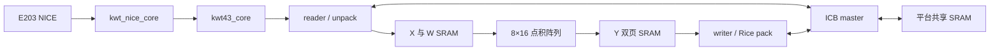

# RTL 文件清单与模块关系

从 `final/` 按 `rtl.f` 读取 15 个 `.sv`。顶层为 `kwt_nice_core`，外部为 32 位 NICE 与 ICB。`interface/e203_subsys_nice_core.v` 是 P6 对接参考，平台集成时由任务 3 文件清单选择。

| 模块 | 作用 |
|---|---|
| `kwt_nice_core` | 接收并寄存 NICE 指令和描述符地址，读描述符，校验窗口、格式和层号，启动矩阵计算并返回状态 |
| `kwt43_icb_master` | 单笔在途，命令、应答分别寄存，支持反压、同拍或延迟应答及错误返回 |
| `kwt43_core` | 管理任务状态、四路数据和 SRAM 页面，协调装载、计算与写回 |
| `kwt43_reader`、`kwt43_unpack` | 读取 X、W、偏置和 Rice 头，解码四条输入流并装入相应缓冲 |
| `kwt43_xram`、`kwt43_wram`、`kwt43_yram` | X 8 个银行，W/Y 各两页，每页 16 个银行。读有效和页标签随请求对齐 |
| `kwt_sp_ram` | 本地单口 SRAM 封装。下降沿锁存请求，宏在上升沿采样。SMIC40 映射分支含 A/D 输入驱动 |
| `kwt43_compute`、`kwt43_dot` | 调度 8×16 阵列，完成长度 64 点积、偏置和 40 位分段累加 |
| `kwt_mul16_pipe`、`kwt_quantize` | 有符号 16×16 流水乘积，最近偶数舍入、int16 饱和与饱和标记 |
| `kwt43_writer`、`kwt_rice_pack` | 读 Y 页，按冻结参数生成四路输出码流，按 ICB 应答完成写回 |

仿真默认用 `verification/tb/kwt_sram_sim.sv`。服务器宏仿真定义 `KWT_USE_FOUNDRY_SRAM` 并读厂商功能模型。SMIC40 综合同时定义 `SYNTHESIS`，链接 8 个 RAMSP1024X16、64 个 RAMSP128X16 和 `BUFV4_12TH40`、`BUFV16_12TH40`。库、宏及约束由 P6 复验流程提供。 [接口格式](../interface/README.md) [复验](../flow/README.md)
