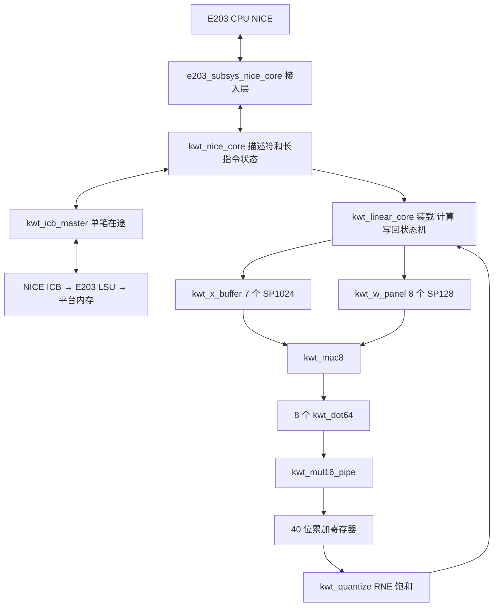

# KWT 线性加速器实现规格

本版固定 M=99、K=64、N=256、8 路并行、batch=1。只有明确暴露的 SRAM 深度、半字装配顺序和合法内存窗口可配置；改维度、lane 数或数值格式需要新版本与回归。

## 模块关系



| 模块 | 实际功能 |
|---|---|
| `kwt_nice_core` | 指令检查、描述符 8 字读取、参数锁存、描述符重叠检查、任务启动、响应保持；将描述符与核心访存分时送入 master |
| `kwt_linear_core` | X 全装载、32 个 W 列组装载；当前行写回与下一行计算重叠；8 bias 寄存器、结果保持与 4 字写回；检查范围和全部对象不重叠 |
| `kwt_icb_master` | 逻辑请求变为固定 size=word 的 ICB 命令；命令保持、读写应答、同拍应答支持、错误锁存 |
| `kwt_x_buffer` | 13 bit 半字索引；高 3 bit 选 7 个 bank，低 10 bit 选宏内地址；读 bank 与 valid 寄存对齐 |
| `kwt_w_panel` | 每 lane 一个独立单口 bank；一次 32 bit 装载并行写两个 lane；计算时 8 个 bank 同读 k |
| `kwt_mac8` | 8 路命令/数据共同握手，结果全部有效才共同接收；广播 X，独立 W/b/acc |
| `kwt_dot64` | 接受 bias 后恰好接收 64 对输入，乘法流水排空后量化，结果保持到 out_ready |
| `kwt_mul16_pipe` | 三级：操作数寄存、并行部分积、精确合并；完整 32 bit signed 乘积，II=1，valid/last 同步推进 |
| `kwt_quantize` | 40 bit signed 累加值最后一次 RNE 与 int16 饱和 |
| `kwt_sp_ram` | 仿真 SRAM、厂商宏包装、综合真实 cell 三种明确编译分支 |

原架构中的 task/matrix/mover/pack/alignment 职责保留，但没有为每项机械拆成一个文件；控制合并在 `kwt_nice_core` 和 `kwt_linear_core`，读对齐在两个缓存中，写保持在核心和 master 中。

## 数值契约

F 表示二进制小数位数，真实值等于 signed 整数乘 `2^-F`，避免不同 Q 命名法对符号位的歧义。

| 对象 | 位宽 | F | 处理 |
|---|---:|---:|---|
| X | 16 | 11 | 软件离线 RNE 后饱和；RTL 接收编码值 |
| W | 16 | 16 | 同上；逐层读取指定第一 Dense kernel |
| bias | 32 | 27 | 同上；每个输出只在累加初始化时加一次 |
| product | 32 | 27 | 完整 signed 乘积 |
| accumulator | 40 | 27 | 符号扩展后累加全部 64 项，无中间截断 |
| Y | 16 | 11 | 对 accumulator 除以 65536 做 RNE，再饱和至 [-32768,32767] |

RNE 是最近偶数：例如 +0.5→0、+1.5→2、-0.5→0、-1.5→-2。RTL 使用算术右移得到 floor 商，低 16 bit 是非负余数；大于半程或恰好半程且商为奇数时加一。`saturated` 仅在舍入后超 int16 范围时置位。40 bit 覆盖任意 64 个合法 int16 乘积加任意 int32 bias，不需要累加环绕。

## 存储和访问次序

| 对象 | 数据量 | 内部组织 |
|---|---:|---|
| X | 12,672 B | 7×1024×16，物理 14 KiB；最后一个 bank 只使用部分地址 |
| 当前 W | 1,024 B | 8×128×16，物理 2 KiB；每 bank 只用 k=0..63 |
| 当前 bias | 32 B | 8 个寄存器 |
| 当前 Y | 16 B | 8 个结果寄存后顺序写 4 个字 |

内部 SRAM 共 16 KiB、15 个宏。`W_BANK_AW=10` 使用 8 个 SP1024 代替 SP128，总物理容量 30 KiB；不会改变算法。两种深度已用本地模型回归，真实宏测试默认 AW=7。

外存为行优先，无离线 W 转置要求：

```text
X 半字地址 = X_base + 2*(64*m+k)
W 半字地址 = W_base + 2*(256*k+n)
b 字地址   = B_base + 4*n
Y 半字地址 = Y_base + 2*(256*m+n)
W 读字地址 = W_base + 512*k + 16*g + 4*j
Y 写字地址 = Y_base + 512*m + 16*g + 4*j
g=0..31, m=0..98, k=0..63, j=0..3
```

`PACK_LOW_FIRST=1` 把相邻低索引元素放 wdata[15:0]；设为 0 则交换半字。这个参数只调整 32 bit 总线字内部的两个 int16，不是完整 CPU 大小端转换；bias 和描述符仍须按平台 32 bit 字语义提供。

按下列顺序推进：X 的 3168 次字读取→每字两个单口写周期；每组 W 的 256 次字读取→每字两个不同 lane 同拍写；8 个 bias 字读取；对 99 行各发 64 次 SRAM 读。当前行结果进入 y_hold 后，在写回其 4 个 Y 字期间计算下一行；慢写回时下一行结果保留在 MAC 响应寄存器中。当前行四次写应答全部成功后才推进 row_m 并接收下一行结果，99 行全部完成后才更换 W/b。没有跨组参数预取或多笔 ICB 在途。

prefetch_state 的 INIT/FEED/DRAIN 和 prefetch_row 管理下一行，主状态机仍独占 ICB。两个结果槽为原有 y_hold 与 MAC 输出寄存器，不增加 SRAM。新增同步 clear 清除乘法 valid/last、dot 状态与预取状态；任务空闲、完成或 Y 写应答错误时触发，错误后下一任务无需全局复位。clear 不改变外部 NICE/ICB 端口，也不生成新时钟或门控复位。

每任务数据事务：X 3168、W 8192、bias 256、Y 写 12672，共 24288 个 32 bit 事务；另有 8 个描述符读，总计 24296。64×99×32=202752 仅是操作数发射拍数，不是任务总周期。

## 握手和复位

`valid && ready` 才算一次传输；在等待 ready 时命令和最终响应保持。外部内存写也必须等待应答，最后一个写应答成功才进入完成。master 同时仅有一个已接收事务，出现错误时无需取消多笔队列，已收到错误应答后停止新的命令，部分输出作废。

X/W 宏在上升沿接收地址，数据在该沿之后输出；接收乘法器在下一上升沿消费。缓存 valid 和 X bank 同步寄存，FEED 发出 64 个请求后 DRAIN 接收最后返回及乘法结果。计算阶段 MAC 不允许反压 SRAM 返回，系统测试显式检查了这一不变量。

低有效复位清控制、valid、计数和输出寄存器，不复位宏阵列。新任务必须完整装载 X 和当前 W/b 后才读取。复位测试同时复位总线应答域；单独复位 NICE 而保留旧 ICB 应答不受支持，正式系统必须整域复位或增加排空/隔离逻辑。无总线响应时允许一直等待，当前没有硬件超时或自动重试。

## 合法范围与错误

描述符、X、W、b、Y 必须全部位于同一个已配置的连续合法区间、4 B 对齐且互不重叠。范围加法使用 33 bit 检测 32 bit 地址回绕；不允许原地覆盖输入。layer 只验证 0..11 并记录任务身份，不自动定位权重，固件必须给出与该层匹配的 W/b。

status：0 成功；1 地址/重叠；2 数据读错误；3 输出写错误；4 非法层号；0x10 指令错误；0x11 描述符地址错误；0x12 格式错误；0x13 描述符读错误；0xFF 非法状态。所有非零状态都置 `nice_rsp_err`，在实际 E203 中可能形成异常，不能假设 C 调用会正常返回错误码。
