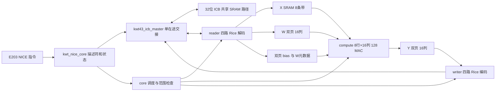

# v4.3 架构和相对于 v4.2 的改进

## 运算边界与不变的数值

每任务接收当层 X[99,64]、W[64,256]、b[256]，输出 Y[99,256]。每个元素进行 64 次有符号乘积与一次偏置相加，一任务为 1,622,016 MAC。输入/权重是 Q4.11 int16，偏置与累加使用原接口的 32/40 位表示；最终 F27→F11 使用最近偶数舍入和 int16 饱和。X/W/Y 的每层步长和 Y 的列 Rice 参数直接冻结自 v4.2 的 profile42，不重新标定。

硬件输出仍为 Dense1 的矩阵。MFCC、注意力、残差、归一化、Dense2 和分类头属于完整 KWT 语言识别链，必须由软件/其他实现衔接。12 个 Dense1 输入来自对应层的完整模型，不能把一层 Dense1 输出直接喂给下一层 Dense1。当前精度证明是这些矩阵的 NRMSE，不能改称量化全模型的词分类准确率。

## 数据与控制关系

| 项目 | v4.2 | v4.3 | 改动目的 |
|---|---|---|---|
| 阵列 | 4×8，32 MAC | 8×16，128 MAC | 同时复用每个 W 到 8 行、每个 X 到 16 列 |
| 符号处理 | 1 个 Rice 符号/拍 | 4 路各 1 符号/拍 | 解除单串流编解码瓶颈 |
| ICB | 单在途，事务间空拍 | 单在途，应答消费与下一命令可同拍 | 利用公共一拍 SRAM 路径，不扩大端口 |
| W/Y 页面 | 每组 8 列 | 每组 16 列，W/Y 各两页 | 装入、运算和写回可以交叠 |
| MAC 累加 | 上版分段路径 | 14/13/13 位延迟进位，独立结果归并 | 避免每拍完整 40 位串行进位 |
| 局部物理容量 | 24 KiB，40 宏 | 32 KiB，72 宏 | 增加端口与双页，以容量换复用 |
| 外部格式 | 0x10003 | 0x10004，四个独立子流 | 四路无相互串行依赖，槽地址仍可直接计算 |
| 量化精度 | profile42 | 同一份 profile42 | 性能改进不靠进一步损失数值精度 |

## 为什么这次从八列扩大到十六列

八列原本契合八条权重 SRAM、八个输出通道，以及 32 位单在途总线较慢的供数速度，控制和面积都容易收敛。继续加乘法器而不解决码流和握手，会让新乘法器等待数据。

本版先把外部流分成四路，每路一次处理四个列通道，再给每列一个单口权重银行；所以一拍能读出 16 个 W，广播给八行。X 的每行元素同时送给 16 列，W 的每列元素同时送给八行，128 个 PE 不需要 128 份独立的 SRAM 端口。16 列下每任务 16 组，而 v4.2 是 32 组，组切换和元数据访问也减少。代价是乘法和流水寄存器增加、总面积约为 v4.2 的 2.63 倍。因此没有继续扩大到 32/64 列。

一个组计算 13 个行块，每块 8 行、64 个 k，共 832 次读发射；第 100–104 行只用于规整硬件，只有第 0–98 行会提交。16 组的理想发射下界为 13,312 拍；完整任务还要计入冷装载、字头、读写交接和流水排空。固定样本实际约 1.6 万拍/任务。

## 稳定的流水与页面所有权

1. 读完整 X，交错四个行子流，写入八个单口条带；X 在本任务内被 16 个列组反复使用。
2. 装入第 0 组 W、偏置和输出 Rice 参数到 W 页 0。
3. 启动当前组计算，同时读下一组 W 到另一个 W 页。当前 W 页只读，下一 W 页只写。
4. 上组的 Y 页已经完成；在总线空档编码并写回它。Y 的双页与 W 的双页独立，下一组的 W 参数不会覆盖待写回 Y 的参数。
5. 当前运算和该轮 DMA 均结束后切组。最后一组写应答完成才发 NICE 响应。

`w_keys[page]` 在装 W 时更新；`y_keys[page]` 在启动该组计算时快照。两者不能合成同一份元数据，这是避免预取跨页污染输出的重要条件。总线的每个返回字也有子流归属和预留 FIFO 信用，遇到反压或错误先收完已发事务再退出。

## 乘法、累加、舍入

乘法沿用经过验证的流水分解。新累加器将 40 位拆成 14/13/13 位，段间进位延后一拍；结束时的归并单独流水，不阻塞下一条 64 项点积开始。额外保留的进位与末项快照必须一起归并，测试用独立 64 位有符号总和对照。

当前 profile 的 sx≥1、sw≥3，因此乘法输入最低 1/3 位必为零。RTL 明确连接这些零位，让综合删除无效部分积；这在允许的量化域内完全精确。描述符拒绝 sx<1 或 sw<3，不能用这些参数偷偷运行别的精度。内部操作仍是 int16，而不是把任意 int16 都当成只有低位为零的数。

## SRAM、面积与时序

| 用途 | 宏组织 | 宏数 | 物理容量 |
|---|---|---:|---:|
| X | 8×1024×16 | 8 | 16 KiB |
| W | 两页×16列×128×16 | 32 | 8 KiB |
| Y | 两页×16列×128×16 | 32 | 8 KiB |

这些 SRAM 在正式综合中是真实公共库宏，不是被忽略面积/延迟的寄存器数组。外部共享 512 KiB RAM 不在加速器面积内。完整综合约 1.044 mm²，其中局部 SRAM 宏约 0.2445 mm²；面积主增量来自阵列、流水和控制。关键建立路径当前在 Rice reader，而非 SRAM 或 40 位 MAC。最终数字以 [工艺报告](SERVER_RESULTS.md) 和 [ppa.json](results/ppa.json) 为准。

综合以 5.2 ns 为优化目标，独立 STA 在 6.666667 ns 报告。报告使用 0.15 ns 建立不确定度、0.10 ns 保持不确定度；没有多周期/伪路径例外。额外优化约束仅用于修复复位短路径，报告恢复原约束。删除无负载死逻辑的 ECO 由 Formality 等价证明。150 MHz 的慢角余量大于 1 ns，留给 CTS、布线和提取继续消耗，但仍须完成布局后签核。

## 吞吐、功耗与后续边界

公共 E203 控制器源码使用 DP=1、CUT_READY=0 的响应级，允许一拍 SRAM 连续交接；本版没有假设多个同时未返回的请求。公共完整 SoC 的共享 RAM 仍是待补的平台部分，所以只证明控制器加同步存储端点的条件性能。随机 0–7 拍应答延迟的旧压力 BFM 仍测量，它比一拍 SRAM 更慢；两种结果必须分别引用。

面积和平均功耗都会受 128 个 MAC 影响。评价还应看每任务能量：平均功耗×NICE 活动时间。功耗脚本使用完成整张真实矩阵的门级 SDF VCD，而不是假设任意固定翻转率代替主要计算活动；未覆盖节点和宏功耗模型情况在结果中明确列出。CPU、外部共享 RAM、互连、时钟树及提取寄生不在该子系统测量中。

数据复用和增加本地带宽是主流阵列设计方法，可参考 MIT [Eyeriss ISCA 2016](https://eems.mit.edu/wp-content/uploads/2016/04/eyeriss_isca_2016.pdf)。本版是普通广播的分块矩阵阵列，未宣称照搬该论文或用其数字代替本设计的实测。
